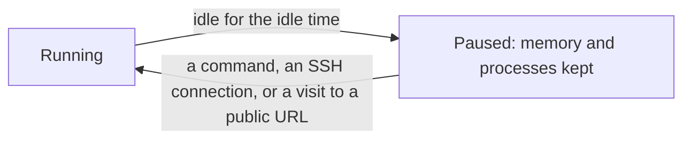

> ## Documentation Index
> Fetch the complete documentation index at: https://instabox.sh/docs/llms.txt
> Use this file to discover all available pages before exploring further.

# Auto-pause and max-run

> When a machine pauses by itself, what wakes it, and the cooldown after a maximum runtime.

Auto-pause puts a machine to sleep when nothing is using it, and the machine wakes on the next use
with its memory and processes kept. It suits a dev machine you leave overnight, an agent's machine
that waits between tasks, and a preview server that is only opened now and then.

By default a machine pauses once it has been idle for 30 minutes. You can change the
idle time when a job needs a shorter or longer wait, and you can set a maximum runtime to cap how long
a machine runs without a break.



```bash theme={null}
instabox auto-suspend job 10m
```

## Change the idle time

The idle time is how long a machine waits with nothing using it before it pauses. You can shorten it
so that a finished job pauses sooner, or lengthen it for a machine that should stay up between bursts
of work. The setting is kept across pause and resume, so you set it once.

On a paid plan you choose the time, but on the free plan the time is fixed. The range for each plan
is under [Limits](#limits).

```bash CLI theme={null}
instabox auto-suspend job 10m
```

```ts TypeScript theme={null}
import { Sandbox } from '@insforge/instabox-sdk'

const sbx = await Sandbox.connect('job', { resume: false })
await sbx.setAutoSuspend(10 * 60 * 1000)
```

```python Python theme={null}
from instabox import Client

client = Client()
client.machines.update("job", auto_suspend_after_seconds=600)
```

```bash API theme={null}
curl -X PATCH https://api.instabox.sh/v1/machines/m_... \
  -H "X-API-Key: $INSTABOX_API_KEY" \
  -H "Idempotency-Key: $(uuidgen)" \
  -H "Content-Type: application/json" \
  -d '{"autoSuspendAfterSeconds": 600}'
```

## Turn off the idle pause

If a machine must keep running even when nothing is using it, you can turn the idle pause off. On a
paid plan, set the idle time to `0`, and the machine then never pauses because it is idle.

```bash theme={null}
instabox auto-suspend job 0
```

## Set the idle time at create

When you already know the idle time that a machine needs, you can set it as you create the machine,
so there is no second command to run. The CLI takes a duration with `--auto-suspend`. The API takes a
number of seconds as `autoSuspendAfterSeconds`, and the TypeScript SDK takes milliseconds as
`autoSuspendMs`.

```bash CLI theme={null}
instabox create --name job --auto-suspend 10m
```

```ts TypeScript theme={null}
const sbx = await Sandbox.create({
  name: 'job',
  autoSuspendMs: 10 * 60 * 1000,
})
```

```bash API theme={null}
curl -X POST https://api.instabox.sh/v1/machines \
  -H "X-API-Key: $INSTABOX_API_KEY" \
  -H "Idempotency-Key: $(uuidgen)" \
  -H "Content-Type: application/json" \
  -d '{"name": "job", "autoSuspendAfterSeconds": 600}'
```

## What counts as idle

A machine is idle when no coding agent is working in it, no terminal or SSH traffic is flowing, and
its CPU has no load. An exec, a file read, a public port request, or a task lease that is in progress
keeps the machine busy, so it is not paused in the middle of one. When a signal is missing or unclear,
the machine counts as busy.

## Keep a machine awake during a silent task

Some tasks wait for a long time without any output, for example a task that waits on a model API.
Such a task looks idle from the outside, so the machine can still be paused under it. To keep the
machine awake, you can hold a lease for as long as the task runs.

Take the lease with `PUT /v1/machines/{id}/activity-leases/{taskID}`. The `{taskID}` is a name you
choose for the task, and `ttlSeconds` in the body says how long the lease lasts.

```bash theme={null}
curl -X PUT \
  https://api.instabox.sh/v1/machines/m_.../activity-leases/task-1 \
  -H "X-API-Key: $INSTABOX_API_KEY" \
  -H "Content-Type: application/json" -d '{"ttlSeconds": 300}'
```

A lease ends when `ttlSeconds` runs out, so renew it before then if the task is still running. To
renew the lease, send the same request again with the same `{taskID}`.

When the task ends, release the lease with a `DELETE` on the same path, so that the machine can pause
again once it is idle.

```bash theme={null}
curl -X DELETE \
  https://api.instabox.sh/v1/machines/m_.../activity-leases/task-1 \
  -H "X-API-Key: $INSTABOX_API_KEY"
```

> [!NOTE]
>
> On the free plan a lease keeps the machine from an idle pause, but it does not make the run longer.
> A run that only a lease keeps up ends when its time is up. See
> [Runtime on the free plan](#runtime-on-the-free-plan).

## What wakes a machine

A machine that paused **itself** resumes when you use it again, and you can recognize one by the
`autoSuspendedAt` field being set. A request that wakes the machine waits up to 45 seconds for the
resume and then runs. If the resume is still running after that, the answer is a retryable
`409 operation_conflict` that names the operation. The table lists each action, and a row says so when
it behaves differently.

| Action | Wakes it? | Notes |
| - | - | - |
| `instabox exec` (`POST /v1/machines/{id}/exec`) | Yes | Waits for the resume. |
| `instabox ps` (`GET /v1/machines/{id}/processes`) | Yes | Waits for the resume. A machine you paused or stopped shows the list read before it went down. |
| List, read, or write files (`GET /v1/machines/{id}/files`, `GET .../files/content`, `PUT .../files`) | Yes | Waits for the resume. A signed upload URL wakes it when used, not when created. |
| `instabox ssh`: the certificate request (`POST /v1/machines/{id}/connections`) | Yes | Waits for the resume. If the answer is the `409`, the CLI prints `Waiting for <name> to wake up…`, waits up to 5 more minutes for the operation, and asks again. `ssh-cert`, `ssh-config`, `mosh` and `port-forward` do the same. |
| An SSH connection through the gateway, with a certificate or an SSH token | Yes | Waits up to 15 seconds. If the resume is still running, the connection is refused with `machine ... is waking up; try again in a few seconds`. |
| A request to a public port URL (HTTP) | Yes | The request waits for the resume. If the resume is still running, the answer is `503` (Sandbox is waking up) with `Retry-After`. |
| A raw TCP connection to a public port | Yes | The connection waits up to 45 seconds for the resume. If the resume is still running, or the machine cannot run, the server closes the connection after the TLS handshake with no answer. Connect again. Once open, it counts as activity only while bytes flow. |
| A request to a private port without its token | No | Refused with `401` (`403` for a wrong `_token`) without waking it. |
| The dashboard's **Computer** or **Files** tab | Yes | Opening the tab sends `POST /v1/machines/{id}/wake`. |
| The dashboard terminal (`GET /v1/machines/{id}/terminal`) | Yes, when you open it | Its automatic reconnects send `wake=0` and get a retryable `409 machine_not_running` instead. |
| Desktop `install`, `start`, `takeover`, or `handback` (`POST /v1/machines/{id}/desktop`) | Yes | On a template whose desktop is the VM's own screen, these return `409 machine_not_running` instead. |
| Desktop `status`, or the desktop stream (`GET /v1/machines/{id}/vnc`) | No | `409 machine_not_running`. |
| `instabox wake` (`POST /v1/machines/{id}/wake`) | Yes | Waits for the resume. Counts toward the plan's starts a minute. |
| Take a lease (`PUT /v1/machines/{id}/activity-leases/{taskID}`) | Yes | Waits for the resume. Releasing a lease (`DELETE`) does not wake it. |
| MCP `exec`, `read_file`, or `write_file` | Yes | Runs the REST route above, so it waits the same way. |
| `instabox get`, `instabox ls`, `instabox logs`, exec history (`GET /v1/machines/{id}/history`) | No | Reads what the server stored. |

A GitHub Actions job keeps its CI machine awake while the job runs. It does not wake a paused one.

> [!NOTE]
>
> A machine **you** paused or stopped does not wake on use, and `instabox wake` does not wake it
> either. Run `instabox resume` or `instabox start` to bring it back. Until then its public URLs return
> `503` (Sandbox offline), with the command to run in the body.

## Set a maximum runtime

A maximum runtime caps how long a machine runs without a break. When you set one on a paid plan, the
machine is paused after that many minutes of continuous running, **even while it is busy**. Activity
and leases do not extend a runtime you set. On the free plan the service sets the runtime instead, and
use extends it: see [Runtime on the free plan](#runtime-on-the-free-plan).

The CLI takes the minutes with `instabox max-run`, and the API takes them as `maxRunMinutes`. This
example pauses the machine after 60 running minutes.

```bash CLI theme={null}
instabox max-run job 60
```

```bash API theme={null}
curl -X PATCH https://api.instabox.sh/v1/machines/m_... \
  -H "X-API-Key: $INSTABOX_API_KEY" \
  -H "Idempotency-Key: $(uuidgen)" \
  -H "Content-Type: application/json" -d '{"maxRunMinutes": 60}'
```

You can also set the maximum runtime when you create the machine, with `--max-run-minutes`.

The idle pause and the maximum runtime both apply, and whichever comes first pauses the machine. The
next wake starts a fresh run, so the maximum runtime is counted again from that wake.

## Remove the maximum runtime

When a machine no longer needs a cap, you can remove the maximum runtime by setting it to `-1`. A
value of `-1` means unlimited, which is the default for machines on a paid plan.

```bash theme={null}
instabox max-run job -1
```

## Runtime on the free plan

On the free plan the service sets the maximum runtime, and you cannot change it. Each run starts with
120 minutes. While the machine is in use, the service extends the run before
it ends, up to 480 minutes in one run. A machine that is no longer in use pauses
when its time is up, and the [cooldown](#cooldown-after-a-maximum-runtime) starts.

`instabox get` shows the current limit as **Max runtime**, and `instabox get --json` as
`maxRunMinutes`, counted from `runStartedAt`. A paused or stopped machine has no run, so it shows
480, the most a run can last. When the
machine starts or resumes, the limit goes back to 120 minutes and grows again
with use.

> [accordion] How the free plan extends a run
>
> With 5 minutes left before the limit, the service counts in how many of the last 30 minutes the
> machine was in use. The count decides the new limit:
>
> | Minutes in use | The limit |
> | - | - |
> | 5 or more | grows by 120 minutes |
> | 1 to 4 | grows by 30 minutes |
> | None | stays, so the machine pauses when it is reached |
>
> Commands, file access, requests to the machine's ports, desktop use, terminal and SSH traffic, and
> CPU load of a quarter vCPU or more count as use. Activity leases and wake calls keep a machine from
> an idle pause, but they do not count as use here. When the service cannot read the machine's
> activity, the run gets the full 480 minutes. The limit is per run, not per day.

## Cooldown after a maximum runtime

When a machine is paused because it reached its maximum runtime, a cooldown starts, and the machine
cannot wake until the cooldown ends. An idle pause has no cooldown. The cooldown is 5 minutes plus a
random 0 to 15 minutes, so machines that reach their limit together do not all wake together.

> [!WARNING]
>
> Until the cooldown ends, every way of waking or starting the machine (exec, SSH, file reads, public
> URLs, wake, resume, and start) is refused with `409 machine_cooldown`. Stopping, pausing, or changing
> settings does not shorten a cooldown that has already started.

The refusal is marked `retryable: true`, and it carries a `Retry-After` header and `retryAfterSeconds`
in the body, which both give the seconds left. You can also read when the cooldown ends from the
machine's `cooldownUntil` field, which `instabox get` shows and `instabox ssh` prints. Wait that long,
then send the request again.

After the cooldown, a machine whose `maxRunMinutes` is `0` still refuses to wake with
`409 max_run_disabled` until you change the setting.

## Limits

* **Idle time on paid plans:** you can set any whole minute from 5 to 30, or
  `0` to turn the idle pause off. A part minute, or a value outside that range, is refused.
* **Idle time on the free plan:** the time is fixed at 30 minutes, and another value
  is refused.
* **Lease length:** `ttlSeconds` takes a value from 30 to 3600.
* **Maximum runtime on paid plans:** machines default to `-1`. You can set it at create, or later
  with `instabox max-run` or `PATCH /v1/machines/{id}`.
* **Maximum runtime on the free plan:** each run starts at 120 minutes and
  grows while the machine is in use, up to 480 minutes
  ([Runtime on the free plan](#runtime-on-the-free-plan)). Only an admin can override it.
* **A maximum runtime of `0`:** this pauses the machine at once and keeps it from waking until you
  change the setting.

> [accordion] Longer cooldowns on the free plan
>
> On the free plan, back-to-back max-run pauses rest longer. By default:
>
> | Max-run pause in a row | Cooldown |
> | - | - |
> | 1st | 5 to 20 minutes |
> | 2nd | 60 to 75 minutes |
> | 3rd and later | 120 to 135 minutes |
>
> Each step is a base (5, 60, or 120 minutes) plus the same random 0 to 15. The count starts over when
> a run ends with no cooldown owed (an idle pause, or you pause or stop the machine). It also starts
> over when a run starts 2 hours or more after the last cooldown ended. A new or forked machine starts
> at the 1st step. Restoring a machine in place keeps its count. A machine on a paid plan always gets
> the 1st step. The length is fixed when the pause starts, and `cooldownUntil` says exactly when it
> ends.

> [accordion] Lock after a security check
>
> A lock after a security check paused the machine is not a max-run step, and it can last up to 24
> hours. The lock is a cooldown, so it keeps the count. A run started less than 2 hours after the lock
> ends continues the count, and that run's max-run pause can get the 2nd or 3rd step.

> [card] [Lifecycle](https://instabox.sh/docs/machines/lifecycle.md)
>
> Pause, resume, stop, and start by hand.

> [card] [Storage and retention](https://instabox.sh/docs/machines/storage.md)
>
> What is kept, for how long, and the archive and delete deadlines.
